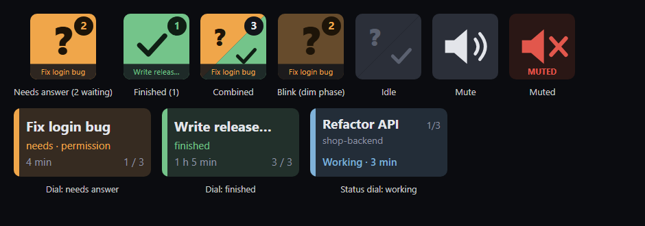

# Claude Notify for Stream Deck

Your Stream Deck lights up when a Claude Code session in the **Claude Desktop app** needs your answer or has finished its task. One press takes you straight to that session.



It comes in two parts that work together:

| Part | What it is | Where |
| --- | --- | --- |
| **Claude Notify** | A Stream Deck plugin: the keys, the dial, the sounds | [`streamdeck/`](streamdeck) |
| **mctonnie-mods** | A Claude Code mod pack. Its *Stream Deck* feature tells the plugin what each session is doing. | [`mod/`](mod) |

## What you get

- **Needs answer** key (amber `?`): blinks while any session waits for you: a permission prompt, a question, a plan to approve, or a next-step question.
- **Finished** key (green ✓): blinks when a session has finished and nothing is left running in the background.
- **Combined** key: both in one, split diagonally. The amber half is for needs answer, the green half for finished.
- **Mute** key: silences all sounds (keys keep blinking). Optional quiet hours.
- **Session browser** dial (Stream Deck +): turn through every waiting session on the touch strip, showing title, kind and age.
- **Session status** dial (Stream Deck +): see what every busy session is doing (blue *Working*, amber *Needs approval* / *Asking you*, green *Finished*), with its project folder and how long it's been in that state. The most recent change comes first; turn to switch.

Every waiting key shows a **count badge** and the **title of the session** the next press opens. Each kind plays its own **chime** once when something new arrives, with optional reminders.

| On a key | What happens |
| --- | --- |
| Press | Opens the oldest waiting session in the Claude app. The next press goes to the next one. A finished session counts as seen once opened. |
| Press with nothing waiting | Opens your most recent Claude session. |
| Hold about 1 second | Dismisses everything on that key without opening anything. |

| On the Session browser dial | What happens |
| --- | --- |
| Turn | Step through waiting sessions (needs answer first). |
| Press or tap | Open the one shown. |
| Long touch | Dismiss the one shown. |

| On the Session status dial | What happens |
| --- | --- |
| Turn | Switch between busy sessions (working, needs answer, finished and not yet seen). |
| Press or tap | Open the one shown. A finished one then counts as seen. |

## Requirements

- **Windows 10 or 11.** The plugin uses Windows to play sounds and open links.
- **Stream Deck app 7.1 or newer.** Any Stream Deck works; the dial needs a Stream Deck +.
- **Claude Desktop app** with the Code tab (tested with 4.29). Only sessions in the Desktop app's Code tab are tracked, because only those can be opened by a link.
- **Claude Code with mod support** (function-hook plugins, tested with 2.1.309). This comes with the Desktop app. Mods are an early-access feature of Claude Code, so a future update may change how they work.

## Install

### Option A: let Claude install it

Paste this into a Claude Code session (the Desktop app's Code tab or a terminal):

```text
Please install "Claude Notify" for me from https://github.com/McTonnie/claude-streamdeck. I'm on Windows and have the Stream Deck app and the Claude Desktop app installed.

1. Download the Stream Deck plugin installer from
   https://github.com/McTonnie/claude-streamdeck/releases/latest/download/com.mctonnie.claude-notify.streamDeckPlugin
   to my Downloads folder, then open it with PowerShell's Start-Process so the Stream Deck app installs it. If Stream Deck asks to install, tell me to click Install.
2. Install the Claude Code mod pack by running:
   claude plugin marketplace add McTonnie/claude-streamdeck
   claude plugin install mctonnie-mods@mctonnie
3. Run `claude plugin list` and check that mctonnie-mods is listed and enabled.
4. Tell me to start a NEW Claude Desktop session (the mod loads when a session starts), and to drag the "Claude Notify" actions from the Stream Deck app onto my keys and dial.

Tell me what you're about to run before each step, and don't change anything else.
```

### Option B: install it yourself

**1. The Stream Deck plugin**

Download `com.mctonnie.claude-notify.streamDeckPlugin` from the [latest release](https://github.com/McTonnie/claude-streamdeck/releases/latest) and double-click it. The Stream Deck app installs it.

**2. The Claude Code mod pack**

In the Claude Desktop app, click **+** next to the prompt box, then **Plugins** → **Add marketplace** → enter `McTonnie/claude-streamdeck`, then **Add plugin** → **mctonnie-mods**.

Or from a terminal, at a Claude Code prompt:

```text
/plugin install mctonnie-mods --marketplace McTonnie/claude-streamdeck
```

Answer `y` to add the marketplace and pick the **user** scope. Or from a shell:

```bash
claude plugin marketplace add McTonnie/claude-streamdeck
```

```bash
claude plugin install mctonnie-mods@mctonnie
```

**3. Start a new Claude Desktop session.** The mod loads when a session starts; sessions that were already open stay untracked until restarted.

**4. Set up your deck.** In the Stream Deck app, find the **Claude Notify** category and drag *Needs answer*, *Finished*, *Combined*, *Mute*, *Session browser* and *Session status* (dials) where you want them.

To test, ask the new session something that needs your approval: the Needs answer key should blink and chime.

## Settings

**Per key** (select the key in the Stream Deck app):

| Setting | Default | Meaning |
| --- | --- | --- |
| Sound | the key's own chime | Needs (rising two-note), Finished (soft ding), Reminder tick, or your own `.wav` / `.mp3` |
| Volume | 70 | 0 to 100. Changing a sound or the volume plays it once as a preview. |
| Remind every | 5 minutes (dial: off) | Repeats the chime while something is still waiting: off, 2, 5, 10 or 15 minutes |
| Reminder sound | quiet tick | The tick, or the same sound as the chime |
| Session title | on | Shows the next session's title along the bottom of the key |

Combined and the dial have a separate sound for each kind.

When several keys show the same event, it plays **one** sound. The settings come from the Needs answer or Finished key if one is on screen, otherwise from Combined, otherwise from the dial.

**Mute key:** press to toggle. In its settings, **Quiet hours** (off by default) silences sounds every day between two times, for example 23:00 to 08:00. The key shows `MUTED` or `QUIET` while sounds are off.

**In Claude:** the mod pack adds a **⚙ McT Mods** button to the prompt footer (also `/mct-mods`). Its *Stream Deck* section turns reporting on or off.

## How it works

```text
Claude Desktop session ──(mod: mctonnie-mods)──► ~/.claude/streamdeck/sessions/<session>.json
                                                         │  watched
                                                         ▼
                                     Stream Deck plugin (Claude Notify) ──► keys, dial, sounds
                                                         │  press
                                                         ▼
                                  claude://code/continue?session=<session>  ──► Claude app opens it
```

- The mod listens to Claude Code's own events (permission prompts, questions, the end of a turn, background work, session end). It writes one small JSON file per Desktop session whenever that session's state changes: `working`, `needs` or `finished`.
- The plugin watches that folder and reads each session's title and *archived* flag from the Desktop app's own session list. Archived sessions, and questions whose session has closed, drop off by themselves.
- A press opens the session with the Desktop app's `claude://code/continue?session=…` link. **This link isn't officially documented** (it works in Desktop 4.29), so an app update could change it.
- What you've seen or dismissed, mute and quiet hours are kept in `~/.claude/streamdeck/plugin.json`.

## Privacy

Everything stays on your computer. The mod writes only session ids, state, timestamps, the working folder and a process id to `~/.claude/streamdeck/`. The plugin reads those files and the Desktop app's session titles, and never sends anything anywhere. The key settings pages load Elgato's [sdpi-components](https://sdpi-components.dev) library from its website, like Elgato's own plugin template does.

## Troubleshooting

| Problem | Fix |
| --- | --- |
| Keys never light up | Start a **new** Desktop session after installing the mod. Check that `~/.claude/streamdeck/sessions/` gets a file for it, and that *Stream Deck* reporting is **On** under ⚙ McT Mods. |
| A session never shows Finished | It still has background work running (a command, a subagent). Its state file lists what under `bg`. |
| Pressing doesn't open Claude | Make sure the Claude Desktop app is installed and has opened `claude://` links before. Check the plugin log at `%APPDATA%\Elgato\StreamDeck\Plugins\com.mctonnie.claude-notify.sdPlugin\logs\`. |
| No sound | Check the Mute key and quiet hours, and the key's volume. |
| A terminal session doesn't show | Only Desktop app sessions are tracked. |

## Uninstall

- **Stream Deck plugin:** in the Stream Deck app, open Preferences → Plugins → Claude Notify → uninstall.
- **Mod pack:** run `claude plugin uninstall mctonnie-mods` (or use **+** → Plugins in the Desktop app).
- Optionally delete `~/.claude/streamdeck/`.

## Build from source

See [docs/DEVELOPMENT.md](docs/DEVELOPMENT.md).

## License

[MIT](LICENSE) © McTonnie
